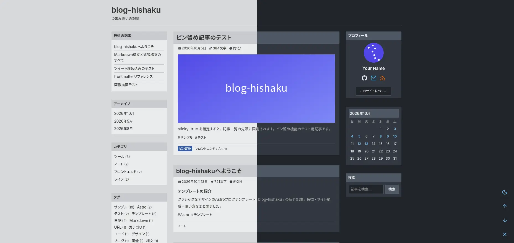
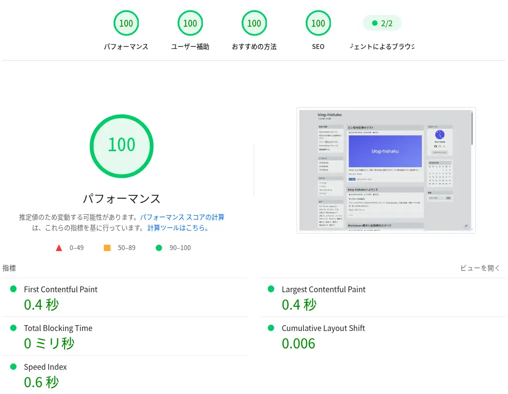

# blog-hishaku

**クラシックなデザインの Astro ブログテンプレート** / A classic-styled blog template built with Astro.



三カラムのクラシックなレイアウトに、日本語ブログに必要な機能をまとめた静的ブログテンプレートです。設定は `config/site.yaml` に集約されており、記事は Markdown で書くだけです。

## 特徴

| 使いどころ | できること |
| --- | --- |
| 記事を書く | 標準 Markdown / GFM、Shoka 系の拡張構文 (note ブロック・折りたたみ・タブ・属性構文)、インライン装飾、ルビ、スポイラー、絵文字画像、Hexo タグ風構文 |
| コードを貼る | Shiki のシンタックスハイライト、タイトル・行ハイライト・コマンドプロンプト・自動折りたたみ・コピー・全画面ボタン |
| 数式 | KaTeX による `$インライン$` / `$$ブロック$$` 数式 |
| リンクを貼る | 独行リンクのカード化 (OGP プレビューカード)、Twitter/X の埋め込み |
| 記事を整理する | カテゴリ (ツリー表示)、タグ、アーカイブ、カレンダー、下書き、ピン留め (sticky)、カスタムリンク (`link`)、ページネーション、類似記事 (`pnpm generate:similarities`) |
| 読みやすくする | ライト / ダークテーマ切替、目次パネル、読み込み目安時間・文字数、画像のライトボックス、LQIP (画像プレースホルダ) |
| 検索 | Pagefind によるバックエンド不要の全文検索ダイアログ |
| パフォーマンス | 静的出力、webfont の FCP 待ち遅延読み込み、`prefers-reduced-motion` 対応のアニメーション |
| SEO / 配信 | OGP・JSON-LD・canonical、sitemap.xml、robots.txt、RSS フィード |
| 設定 | `config/site.yaml` 一元管理 (サイト情報・SNS・コンテンツ拡張のオンオフ)、umami 解析 (任意) |

## パフォーマンス

PageSpeed Insights での計測結果です。



> **注:** スコアは計測環境・接続・コンテンツによって変わります。自分のサイトで計測し直してください。

## クイックスタート

要件: **Node.js ≥ 22.12.0** / **pnpm 12.10.1** ([package.json](./package.json) 準拠)

```bash
git clone git@github.com:pithos-day/blog-hishaku.git
cd blog-hishaku
pnpm install
pnpm dev
```

`http://localhost:4321` でプレビューできます。

### 書く

`src/content/blog/<カテゴリ>/` に Markdown ファイルを置きます。

```markdown
---
title: 記事タイトル
date: 2026-10-13
description: meta description と一覧の抜粋に使われます
tags: [サンプル]
categories: [ノート]
---

本文を書きます。
```

| frontmatter | 動き |
| --- | --- |
| `link` | URL のスラッグを指定 (未指定ならファイル名) |
| `updated` | 記事ヘッダに更新日を表示、JSON-LD にも反映 |
| `subtitle` | タイトル下に表示される副題 |
| `sticky` | 記事一覧の先頭にピン留め |
| `draft` | 本番ビルドでは非公開 |
| `keywords` / `description` | SEO 用のメタ情報 |

サンプル記事は `src/content/blog/` にまとまっています。構文の確認には [Markdown構文と拡張構文のすべて](./src/content/blog/tools/custom-syntax.md) が便利です。

### ビルド

```bash
pnpm build     # dist/ に静的出力 + Pagefind のインデックス生成
pnpm preview   # dist/ のプレビュー
```

`dist/` を任意の静的ホスティング (Cloudflare Pages、Vercel、Netlify、nginx など) に置くだけで公開できます。

## 設定

[config/site.yaml](./config/site.yaml) でサイト名・著者・URL・SNS リンク・解析・Markdown 拡張のオンオフなどを変更します。変更後は dev server の再起動 (または再ビルド) が必要です。

| 調べたいこと | 場所 |
| --- | --- |
| サイト情報・SNS・SEO・解析 | [config/site.yaml](./config/site.yaml) |
| Markdown 拡張構文 | [src/content/blog/tools/custom-syntax.md](./src/content/blog/tools/custom-syntax.md) |
| コードブロックの拡張 | [src/content/blog/tools/code-blocks.md](./src/content/blog/tools/code-blocks.md) |
| 数式・リンク・埋め込み | [src/content/blog/tools/math-formulas.md](./src/content/blog/tools/math-formulas.md) / [links-and-media.md](./src/content/blog/tools/links-and-media.md) |
| UI 文言 | [src/i18n/translations/ja.ts](./src/i18n/translations/ja.ts) |

## 謝辞

デザインと実装の参考にさせていただいた、以下のプロジェクトに感謝します。

- [astro-koharu](https://github.com/cosZone/astro-koharu) — Shoka 系構文、LQIP、リンク埋め込み、Pagefind 検索など多くの機能は本テンプレートで再現しています
- [Hexo テーマ Shoka](https://shoka.lostyu.me/computer-science/note/theme-shoka-doc/) — astro-koharu の設計元となった Hexo テーマ

## License

[MIT](./LICENSE)
